<p align="center" width="100%">
  
</p>

# ASCENT

**Aperiodic Signal Complexity Estimation for Neurophysiological Time series**

ASCENT is an EEGLAB plugin to compute entropy, fractal, and aperiodic (1/f) measures on M/EEG data, either on the scalp channels or on the independent components (ICs). It can also be used on any other multichannel signal that EEGLAB can import (e.g., iEEG, ECoG, local field potentials). All measures can be computed from a graphical interface or from the command line, with the same parameters.

## Measures supported

Uniscale measures:
- Sample entropy (SampEn; Richman & Moorman, 2000)
- Fuzzy entropy (FuzzEn; Chen et al., 2009)
- Extrema-segmented entropy (ExSEnt; Kamali et al., 2026), on the durations and amplitudes of the signal's extrema segments
- Fractal dimension, box-counting (FracDim; Esteller et al., 2001)
- Higuchi fractal dimension (HigFracDim; Higuchi, 1988)
- Aperiodic exponent and offset of the power spectrum (specparam algorithm; Donoghue et al., 2020), static or time-resolved (SPRiNT; Wilson et al., 2022)

Multiscale measures:
- Multiscale entropy (MSE; Costa et al., 2002), with mean, median, standard deviation, or variance coarse-graining (Costa & Goldberger, 2015; Azami & Escudero, 2018)
- Modified multiscale entropy (mMSE; Kosciessa et al., 2020; Kloosterman et al., 2020)
- Multiscale fuzzy entropy (MFE), composite MFE (CMFE; Wu et al., 2013), and refined composite multiscale fuzzy entropy (RCMFE; Azami et al., 2017)

Multivariate measures:
- Multivariate fuzzy entropy (mvFuzzEn; Ahmed & Mandic, 2011; Azami et al., 2016)
- Refined composite multivariate multiscale fuzzy entropy (RCmvMFE; Azami & Escudero, 2017)

All algorithms were modified to significantly increase computation speed while preserving the integrity of the estimates, using vectorization, matrix operations, parallel computing, and blockwise distance calculations that avoid allocating the full pairwise matrix when memory is limited. Some functions used for validation are included from EntropyHub (Flood & Grimm, 2021) and from the original authors of the methods, with their notices.

## Installation

Requires MATLAB and EEGLAB. Download or clone this repository into the `plugins` folder of EEGLAB and restart EEGLAB. An **ASCENT** menu then appears in the EEGLAB menu bar.

## Getting started

### Graphical interface

1. Start EEGLAB and click **ASCENT** in the menu bar.

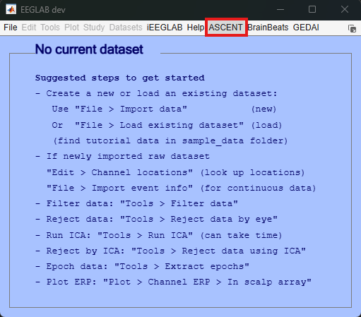

2. If no dataset is loaded in EEGLAB, load one from the ASCENT window (*Load dataset...*), or click *Sample dataset* to load the 64-channel BioSemi recording provided with the plugin (resting state with eyes closed, with an ICA decomposition and dipole fits).

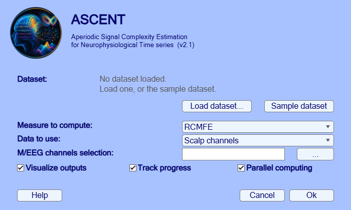

3. Select the measure, the data to use (scalp channels or ICs), the channels (all by default), and whether to plot the outputs, track progress in the command window, and use parallel computing. Then click *Ok*.

4. A second window sets the parameters of the selected measure. Default values follow published guidelines (e.g., m = 2, r = 0.15). For the multiscale measures, users can also choose the coarse-graining method and the number of scale factors.

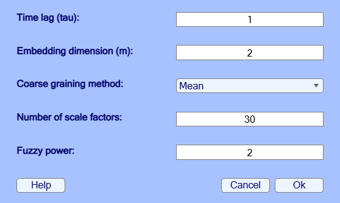

For the aperiodic measure, this window sets the power spectrum estimation and the spectral parameterization (fixed or knee mode, number and width of the peaks), whether to remove the aperiodic component from the spectrum, and whether to also estimate it over time.

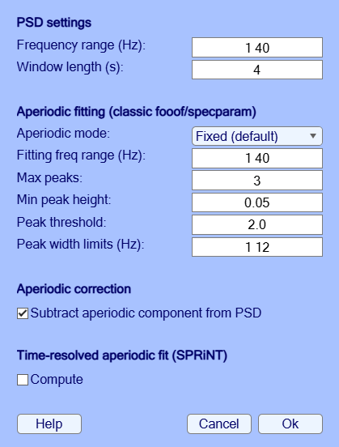

5. The outputs are plotted and stored in `EEG.ascent.<measure>` (e.g., `EEG.ascent.RCMFE.data`, channels x scales). The dataset with its outputs is added to EEGLAB, and the command is saved in the EEGLAB history (type `eegh`), so that the same analysis can be run from a script. If the dataset was not modified since it was loaded, the outputs are also saved in its .set file.

For the multiscale measures, the figure shows the entropy of each channel at each scale with the high-entropy cluster outlined, the scalp topography of this cluster, and its mean entropy across scales. Below, RCMFE computed on the sample dataset:

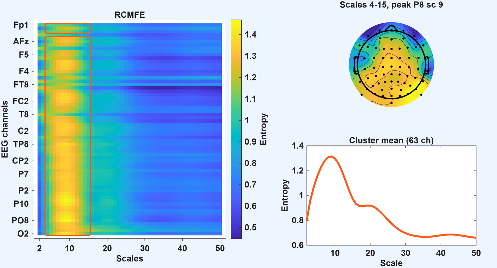

## Tutorial: each measure on the sample dataset

The commands below compute each measure on the sample dataset provided with the plugin (64-channel BioSemi, 75 s of resting state with eyes closed, with an ICA decomposition and dipole fits), with the settings used in the paper. Each call plots its outputs (`'vis', false` to turn this off) and stores them in `EEG.ascent.<measure>`. See `help ascent_compute` for all parameters and `ascent_tutorial.m` for more options.

```matlab
eeglab nogui
pluginPath = fileparts(which('eegplugin_ascent.m'));
EEG = pop_loadset('filename', 'ascent_sample_data.set', 'filepath', pluginPath);
```

### Single-scale measures

```matlab
EEG = ascent_compute(EEG, 'measure', 'SampEn');      % sample entropy
EEG = ascent_compute(EEG, 'measure', 'FuzzEn');      % fuzzy entropy
EEG = ascent_compute(EEG, 'measure', 'ExSEnt');      % extrema-segmented entropy (durations, amplitudes, joint)
EEG = ascent_compute(EEG, 'measure', 'FracDim');     % fractal dimension (box-counting)
EEG = ascent_compute(EEG, 'measure', 'HigFracDim');  % Higuchi fractal dimension

EEG.ascent.SampEn.data                               % one value per channel
```

Parameters can be tuned with name-value pairs, for example `'tau', 1, 'm', 2, 'r', 0.15` for the entropy measures, or `'chanlist', {'Fz' 'Cz' 'Pz'}` to select channels.

### Aperiodic activity (1/f)

```matlab
% Exponent and offset of the power spectrum (specparam algorithm), alpha power before
% and after removing the aperiodic component, and the same over time (sliding windows)
EEG = ascent_compute(EEG, 'measure', 'Aperiodic', 'timeResolved', true);

EEG.ascent.Aperiodic.data.exponent                   % one value per channel
EEG.ascent.Aperiodic.data.offset
EEG.ascent.Aperiodic.data.exp_slid                   % channels x time windows
```

Left: exponent and offset topographies, their correlation across channels, raw and aperiodic-corrected PSD, and alpha power before and after correction. Right: time-resolved spectrograms, exponent, and offset.

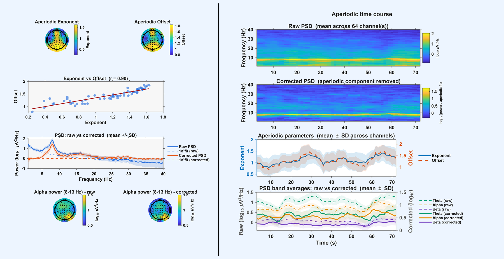

### Multiscale measures

```matlab
EEG = ascent_compute(EEG, 'measure', 'MSE',   'coarsing', 'mean', 'num_scales', 30);  % multiscale entropy
EEG = ascent_compute(EEG, 'measure', 'mMSE',  'coarsing', 'mean', 'num_scales', 30);  % modified MSE
EEG = ascent_compute(EEG, 'measure', 'MFE',   'coarsing', 'mean', 'num_scales', 30);  % multiscale fuzzy entropy

% Refined composite multiscale fuzzy entropy, with mean and standard deviation
% coarse-graining (scales 2-50)
EEG = ascent_compute(EEG, 'measure', 'RCMFE', 'coarsing', 'mean', 'num_scales', 50);
EEG = ascent_compute(EEG, 'measure', 'RCMFE', 'coarsing', 'std',  'num_scales', 50);

EEG.ascent.RCMFE.data                                % channels x scales
EEG.ascent.RCMFE.scales
```

The figure shows the entropy of each channel at each scale, with the high-entropy cluster outlined in orange (channels whose entropy exceeds the 75th percentile over the cluster's scales), its scalp topography, and its mean entropy across scales. Top: mean coarse-graining. Bottom: standard deviation coarse-graining.

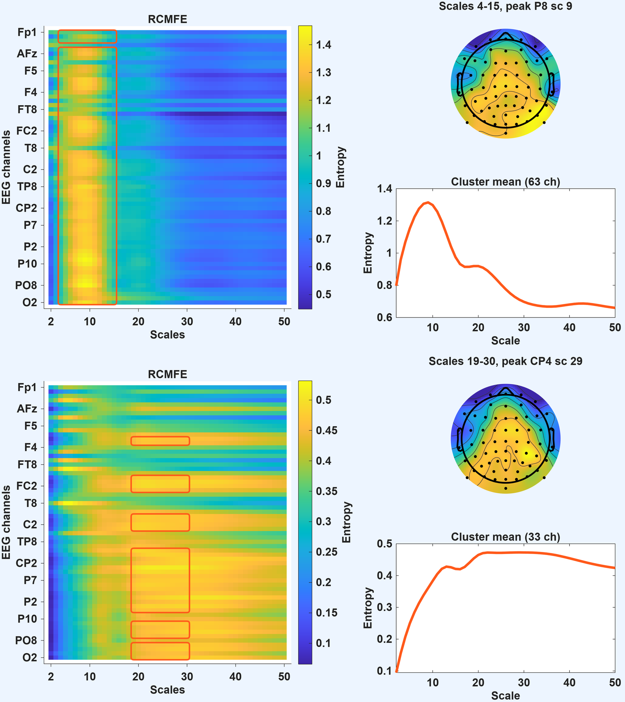

The cluster threshold can be changed when plotting again, e.g. `ascent_plot(EEG.ascent.RCMFE.data, EEG.chanlocs, 'RCMFE', EEG.ascent.RCMFE.scales, 'ClusterThresh', 0.9)`.

### Independent components and dipoles

Any measure can be computed on the independent components (ICs) instead of the scalp channels with `'domain', 'ica'`. IC results are back-projected to the scalp for the topographies. When the dataset has ICLabel classifications, the ICs classified as brain are marked with a dot. When it has dipole fits (DIPFIT), a second figure shows the equivalent dipoles of the dipolar ICs (residual variance < 15%) located inside the brain on the MNI template: color shows the mean entropy of each IC, size the goodness of fit, and shape the ICLabel class (circles: brain; squares: other classes). Each dipole is labeled with its region in the AAL atlas, and the table of ICLabel classes, residual variances and regions is printed and saved in `EEG.ascent.<measure>.ic_info`. ASCENT also warns when the channel locations are not coregistered with the MNI head model (e.g., EEGLAB coordinates used with an identity transform).

```matlab
EEG = ascent_compute(EEG, 'measure', 'RCMFE', 'domain', 'ica', 'coarsing', 'std', 'num_scales', 30);
EEG = ascent_compute(EEG, 'measure', 'Aperiodic', 'domain', 'ica', 'timeResolved', true);
```

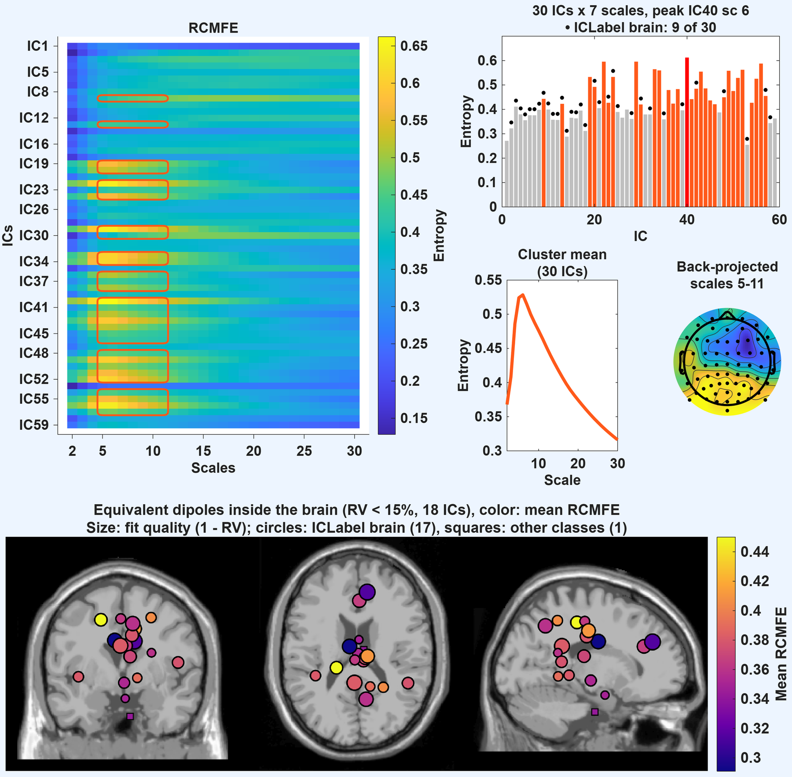

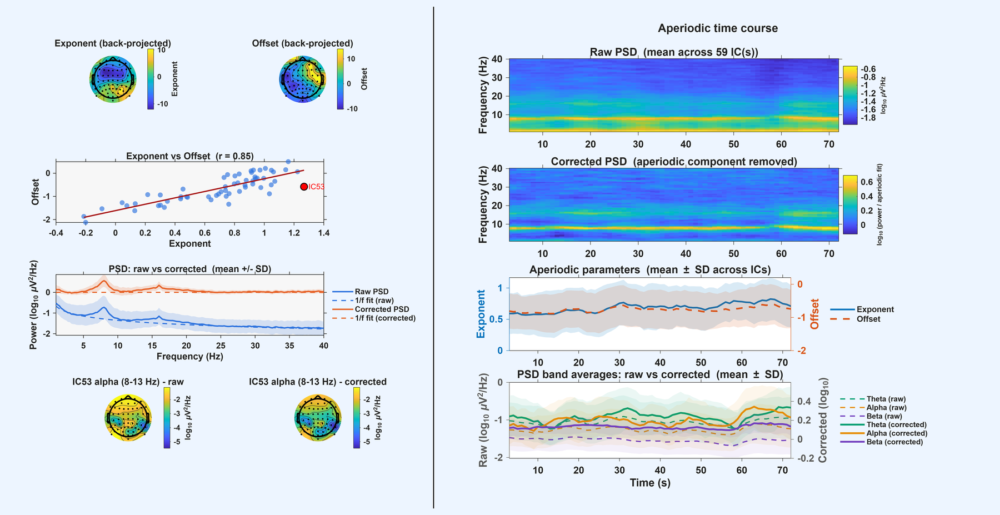

### Multivariate measures

These are computed jointly over the selected channels and can be very long with many channels, so we recommend using them on a few channels, regions of interest, or components:

```matlab
EEG = ascent_compute(EEG, 'measure', 'mvFuzzEn', 'chanlist', {'Fz' 'Cz' 'Pz' 'Oz'});
EEG = ascent_compute(EEG, 'measure', 'RCmvMFE',  'chanlist', {'Fz' 'Cz' 'Pz' 'Oz'}, 'coarsing', 'std', 'num_scales', 10);
```

## Please cite

Cannard, C., & Delorme, A. Introducing the ASCENT EEGLAB plugin: Aperiodic Signal Complexity Estimation for Neurophysiological Time series. Under review. Preprint of an earlier version: https://psyarxiv.com/xwmyk/

Please also cite the papers of the methods you use (see References below).

## Main results (eyes closed vs eyes open, N = 40)

In the paper, we computed these measures on 64-channel BioSemi recordings of 40 participants at rest with eyes closed (EC) and eyes open (EO), and compared the two conditions with paired permutation t-tests (2,000 permutations) and cluster-based correction for the family-wise error (p < 0.05). The script is provided (`ascent_group_analysis.m`).

Single-scale measures (t-values; channels outside significant clusters are masked):

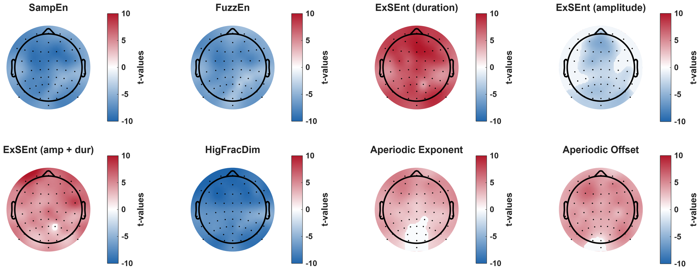

Multiscale measures, with standard deviation coarse-graining:

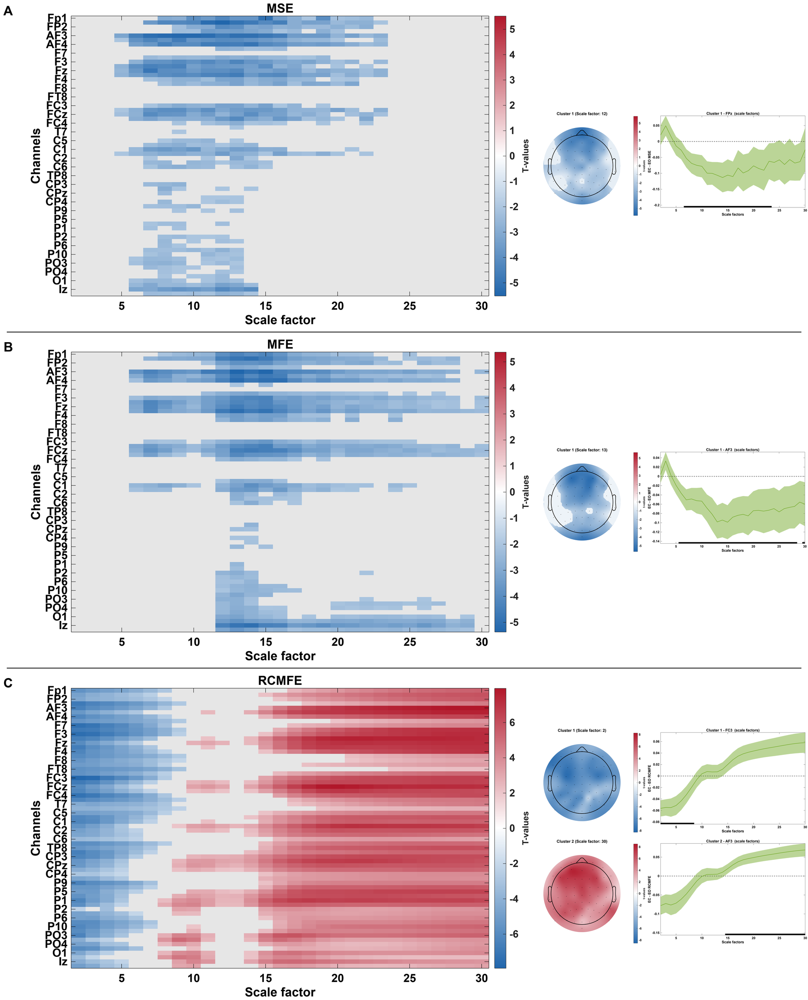

and with mean coarse-graining:

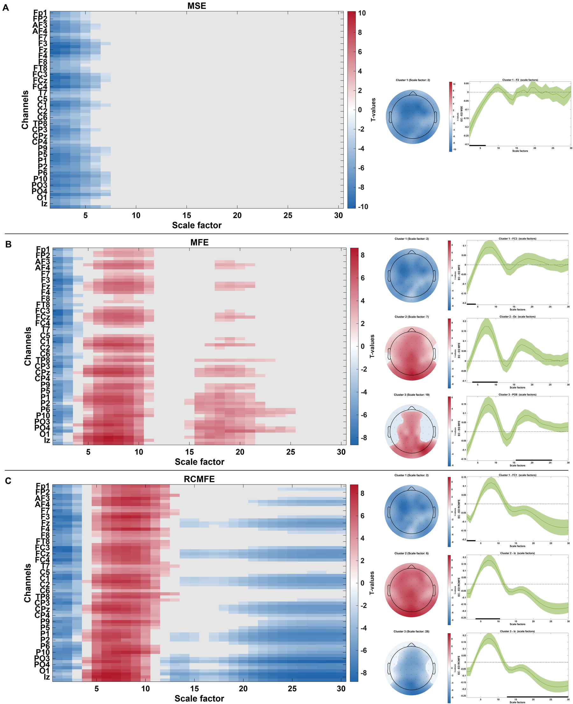

Power spectral density, raw (first) and after removing the aperiodic component (second):

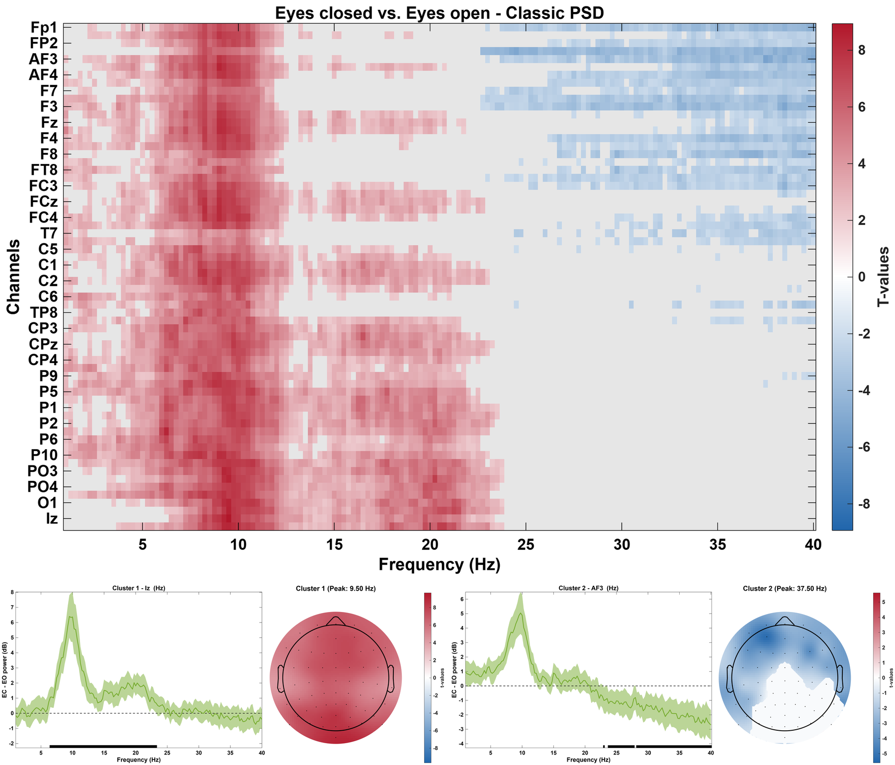

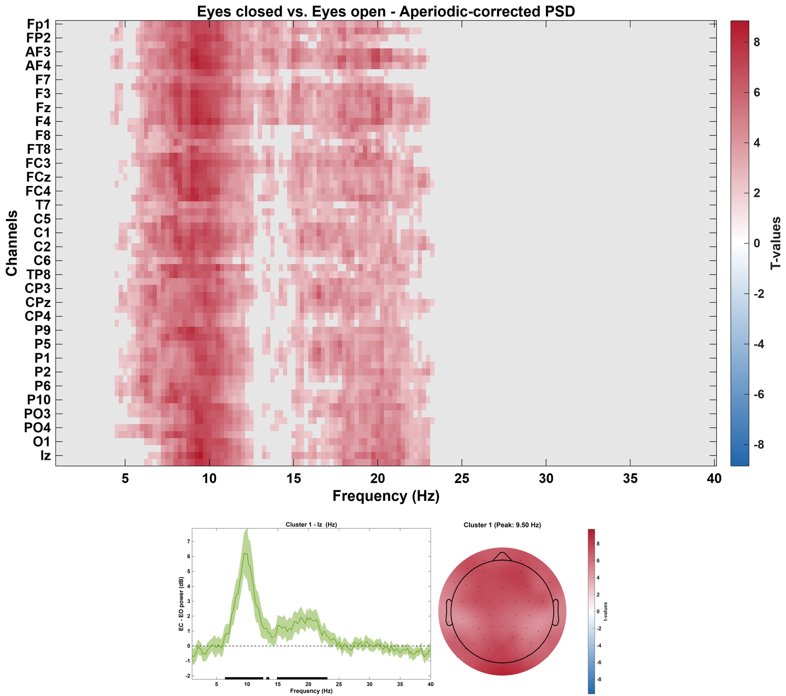

## References

- Ahmed, M. U., & Mandic, D. P. (2011). Multivariate multiscale entropy: A tool for complexity analysis of multichannel data. *Physical Review E*, 84, 061918.
- Azami, H., & Escudero, J. (2017). Refined composite multivariate generalized multiscale fuzzy entropy: A tool for complexity analysis of multichannel signals. *Physica A*, 465, 261-276.
- Azami, H., & Escudero, J. (2018). Coarse-graining approaches in univariate multiscale sample and dispersion entropy. *Entropy*, 20, 138.
- Azami, H., Fernández, A., & Escudero, J. (2017). Refined multiscale fuzzy entropy based on standard deviation for biomedical signal analysis. *Medical & Biological Engineering & Computing*, 55, 2037-2052.
- Azami, H., Smith, K., & Escudero, J. (2016). MEMD-enhanced multivariate fuzzy entropy for the evaluation of complexity in biomedical signals. *Proceedings of the 38th Annual International Conference of the IEEE EMBC*, 3761-3764.
- Cannard, C., Wahbeh, H., & Delorme, A. (2021). Validating the wearable MUSE headset for EEG spectral analysis and frontal alpha asymmetry. *IEEE International Conference on Bioinformatics and Biomedicine (BIBM)*, 3603-3610. (Source of the sample and group datasets.)
- Chen, W., Zhuang, J., Yu, W., & Wang, Z. (2009). Measuring complexity using FuzzyEn, ApEn, and SampEn. *Medical Engineering & Physics*, 31, 61-68.
- Costa, M. D., & Goldberger, A. L. (2015). Generalized multiscale entropy analysis: Application to quantifying the complex volatility of human heartbeat time series. *Entropy*, 17, 1197-1203.
- Costa, M., Goldberger, A. L., & Peng, C.-K. (2002). Multiscale entropy analysis of complex physiologic time series. *Physical Review Letters*, 89, 068102.
- Delorme, A., & Makeig, S. (2004). EEGLAB: An open source toolbox for analysis of single-trial EEG dynamics including independent component analysis. *Journal of Neuroscience Methods*, 134, 9-21.
- Donoghue, T., Haller, M., Peterson, E. J., et al. (2020). Parameterizing neural power spectra into periodic and aperiodic components. *Nature Neuroscience*, 23, 1655-1665.
- Esteller, R., Vachtsevanos, G., Echauz, J., & Litt, B. (2001). A comparison of waveform fractal dimension algorithms. *IEEE Transactions on Circuits and Systems I*, 48, 177-183.
- Flood, M. W., & Grimm, B. (2021). EntropyHub: An open-source toolkit for entropic time series analysis. *PLoS ONE*, 16, e0259448.
- Higuchi, T. (1988). Approach to an irregular time series on the basis of the fractal theory. *Physica D*, 31, 277-283.
- Kamali, S., Baroni, F., & Varona, P. (2026). ExSEnt: Extrema-segmented entropy analysis of time series. *Nonlinear Dynamics*, 114, 980.
- Kloosterman, N. A., Kosciessa, J. Q., Lindenberger, U., Fahrenfort, J. J., & Garrett, D. D. (2020). Boosts in brain signal variability track liberal shifts in decision bias. *eLife*, 9, e54201.
- Kosciessa, J. Q., Kloosterman, N. A., & Garrett, D. D. (2020). Standard multiscale entropy reflects neural dynamics at mismatched temporal scales: What's signal irregularity got to do with it? *PLoS Computational Biology*, 16, e1007885.
- Richman, J. S., & Moorman, J. R. (2000). Physiological time-series analysis using approximate entropy and sample entropy. *American Journal of Physiology - Heart and Circulatory Physiology*, 278, H2039-H2049.
- Wilson, L. E., da Silva Castanheira, J., & Baillet, S. (2022). Time-resolved parameterization of aperiodic and periodic brain activity. *eLife*, 11, e77348.
- Wu, S.-D., Wu, C.-W., Lin, S.-G., Wang, C.-C., & Lee, K.-Y. (2013). Time series analysis using composite multiscale entropy. *Entropy*, 15, 1069-1084.

## Author and license

ASCENT is developed by Cedric Cannard. Copyright (C) 2021-2026 Cedric Cannard. It is free software released under the GNU General Public License v3 or later (see [LICENSE](LICENSE)). Functions included from EntropyHub keep their Apache License 2.0 notice.
